# KlinyShield — Esquema de Base de Datos

**Proyecto:** KlinyShield — SaaS Clínico Multi-Tenant de Alta Seguridad  
**Motor:** PostgreSQL 15+ (Supabase)  
**Migraciones aplicadas:** 40  
**Tablas activas:** 34  
**Funciones SECURITY DEFINER:** 14  
**Row Level Security (RLS):** 100 % de las tablas habilitadas

---

## 1. Visión general de la arquitectura

La base de datos sigue el principio de **Screaming Architecture**: su estructura grita el propósito clínico del sistema desde la primera tabla. No existe un esquema genérico de "usuarios"; el inquilino principal (tenant) es el `professional`, y cada dominio gira en torno a él.

Los pilares de diseño son:

- **Aislamiento multi-tenant estricto:** `professional_id = auth.uid()` en todas las políticas RLS.
- **Event Sourcing en consentimientos:** `patient_consents` y `professional_consents` son tablas _append-only_ (cero UPDATE/DELETE).
- **Agenda Zero-Pre-generation:** la disponibilidad se calcula _on-the-fly_; no existen ranuras pre-generadas.
- **Prevención de Double-Booking ACID:** la función `book_appointment_atomic` usa `SELECT … FOR UPDATE` para serializar reservas concurrentes.
- **Idempotencia en webhooks:** `webhook_events` (WhatsApp) y `subscription_webhook_events` (Fintoc) tienen `UNIQUE(provider_message_id)` y `UNIQUE(fintoc_event_id)` respectivamente; la violación de unicidad (SQLSTATE 23505) se absorbe como Fast-Fail HTTP 200.
- **Cifrado clínico a nivel de aplicación:** `clinical_records.clinical_notes_encrypted` almacena el texto cifrado con AES-256 generado en Next.js; la clave nunca toca la base.
- **Funciones SECURITY DEFINER:** toda la lógica transaccional sensible (reservas, cobros, cambios de plan, publicación de perfil) se ejecuta en RPC con `search_path` fijo para evitar inyección de esquema.

---

## 2. Dominios y tablas

### Dominio 1 — Core Multi-Tenant

| Tabla                                | Propósito                                                         | RLS |
| ------------------------------------ | ----------------------------------------------------------------- | :-: |
| `specialties`                        | Catálogo de especialidades médicas (kinesiólogo, psicólogo…)      |  ✓  |
| `professionals`                      | Entidad principal del sistema; un profesional = un tenant         |  ✓  |
| `professional_credentials`           | Hash Argon2id de la contraseña; separado del perfil por seguridad |  ✓  |
| `professional_trusted_devices`       | Dispositivos de confianza para MFA (SHA-256 de fingerprint)       |  ✓  |
| `professional_profile_publications`  | Perfil público del profesional (borrador / publicado)             |  ✓  |
| `public_booking_identity_challenges` | Desafíos OTP para Magic Links del portal de pacientes             |  ✓  |

```sql
-- Columnas clave de professionals
id                UUID PK
rut               VARCHAR(12) UNIQUE NOT NULL        -- RUT chileno canónico
email             VARCHAR(255) UNIQUE NOT NULL
first_name        VARCHAR(100) NOT NULL
last_name         VARCHAR(100) NOT NULL
specialty_id      UUID FK → specialties
phone_number      VARCHAR(20)
slug              VARCHAR(120) UNIQUE                -- subdominio público
bio               TEXT
created_at        TIMESTAMPTZ DEFAULT now()

-- Columnas clave de professional_credentials
professional_id   UUID PK FK → professionals
password_hash     TEXT NOT NULL                      -- Argon2id
```

---

### Dominio 2 — Agenda Dinámica

| Tabla                    | Propósito                                                                  | RLS |
| ------------------------ | -------------------------------------------------------------------------- | :-: |
| `professional_schedules` | Plantilla semanal de trabajo (día, hora inicio/fin, duración de ranura)    |  ✓  |
| `holidays`               | Feriados nacionales chilenos (sincronizados vía pg_cron desde API externa) |  ✓  |
| `schedule_exceptions`    | Bloqueos manuales de agenda (vacaciones, permisos)                         |  ✓  |
| `appointments`           | Citas reservadas; la disponibilidad se calcula restando estas al schedule  |  ✓  |
| `session_types`          | Tipos de sesión del profesional (precio, duración, nombre)                 |  ✓  |
| `audit_logs`             | Registro inmutable de operaciones sensibles en la agenda                   |  ✓  |

```sql
-- Columnas clave de appointments
id               UUID PK
professional_id  UUID FK → professionals   ON DELETE CASCADE
patient_id       UUID FK → patients        ON DELETE CASCADE
session_type_id  UUID FK → session_types
start_time       TIMESTAMPTZ NOT NULL
end_time         TIMESTAMPTZ NOT NULL
status           VARCHAR(50) DEFAULT 'SCHEDULED'
                 -- SCHEDULED | CONFIRMED | COMPLETED | CANCELLED
reminder_sent_at TIMESTAMPTZ                -- control anti-duplicados del cron
```

**Función transaccional clave:**

- `book_appointment_atomic` — reserva con `SELECT … FOR UPDATE` y validación de solapamiento; garantía ACID de cero Double-Booking.
- `reschedule_appointment_atomic` — reagenda en una sola transacción.

---

### Dominio 3 — Pacientes e Identidad

| Tabla                   | Propósito                                                                 | RLS |
| ----------------------- | ------------------------------------------------------------------------- | :-: |
| `patients`              | Identidad del paciente, creada por el bot al primer contacto por WhatsApp |  ✓  |
| `professional_patients` | Tabla de unión; un paciente puede tener múltiples profesionales           |  ✓  |
| `patient_relationships` | Relación de parentesco/dependencia entre pacientes                        |  ✓  |
| `magic_links`           | Tokens OTP para el Portal Web Seguro del paciente                         |  ✓  |
| `assistant_sessions`    | Estado de la conversación del bot WhatsApp (FSM) por número de teléfono   |  ✓  |

```sql
-- Columnas clave de patients
id              UUID PK
professional_id UUID FK → professionals   -- tenant propietario
phone_number    VARCHAR(20) NOT NULL
first_name      VARCHAR(100)
last_name       VARCHAR(100)
rut             VARCHAR(12)               -- RUT para consentimientos
email           VARCHAR(255)
commune         VARCHAR(100)
region          VARCHAR(100)

UNIQUE(professional_id, phone_number)     -- aislamiento multi-tenant
```

**Función:**

- `request_public_booking_identity` / `verify_public_booking_identity` / `resolve_public_booking_identity` — flujo OTP out-of-band para el portal de reservas públicas.

---

### Dominio 4 — Privacidad y Consentimientos Legales (B2B2C)

| Tabla                   | Propósito                                                     | RLS |
| ----------------------- | ------------------------------------------------------------- | :-: |
| `legal_documents`       | Repositorio de contratos con hash SHA-256 y versión           |  ✓  |
| `professional_consents` | Firma del profesional sobre TOS/DPA del SaaS (Append-Only)    |  ✓  |
| `patient_consents`      | Firma del paciente sobre consentimiento clínico (Append-Only) |  ✓  |

```sql
-- Ambas tablas de consentimientos siguen el mismo patrón:
id              UUID PK
professional_id UUID FK → professionals
document_id     UUID FK → legal_documents
status          VARCHAR(20)   -- GRANTED | REVOKED
ip_address      INET NOT NULL -- capturado server-side, nunca del cliente
user_agent      TEXT NOT NULL
registered_at   TIMESTAMPTZ DEFAULT now()
-- Cero UPDATE ni DELETE permitidos. Cada cambio es una nueva fila.
```

> **Cumplimiento legal:** diseño exigido por la **Ley 19.628** (Protección de Datos Personales), **Ley 21.719** y la **Ley 20.584** (Derechos y Deberes del Paciente). La inmutabilidad se garantiza tanto por política de aplicación como por políticas RLS que solo permiten INSERT.

---

### Dominio 5 — Bóveda Clínica Cifrada

| Tabla                  | Propósito                                                              | RLS |
| ---------------------- | ---------------------------------------------------------------------- | :-: |
| `clinical_records`     | Fichas clínicas; el campo de notas viaja cifrado AES-256 desde Next.js |  ✓  |
| `clinical_attachments` | Archivos clínicos (PDFs, audios, imágenes) en Supabase Storage         |  ✓  |

```sql
-- Columnas clave de clinical_records
id                         UUID PK
professional_id            UUID FK → professionals   ON DELETE CASCADE
patient_id                 UUID FK → patients        ON DELETE CASCADE
appointment_id             UUID FK → appointments    (opcional)
specialty_code             VARCHAR(20)               -- código MINSAL de especialidad
reason_for_visit           TEXT                      -- en claro (no sensible)
clinical_notes_encrypted   TEXT NOT NULL             -- AES-256 cifrado en Next.js
created_at                 TIMESTAMPTZ DEFAULT now()

-- Bucket de Supabase Storage: clinical-records
-- Ruta: {professional_id}/{patient_id}/{record_id}/{filename}
```

> La clave AES-256 (`CLINICAL_ENCRYPTION_KEY`) es una variable de entorno de servidor. Nunca se almacena en la base ni se expone al cliente.

---

### Dominio 6 — Cobros a Pacientes (B2C Payment Links)

| Tabla                        | Propósito                                                                    | RLS |
| ---------------------------- | ---------------------------------------------------------------------------- | :-: |
| `professional_bank_accounts` | Cuenta bancaria del profesional (campos cifrados con AES-256)                |  ✓  |
| `payment_links`              | Payment Links de Fintoc generados por el profesional para cobrar a pacientes |  ✓  |
| `fintoc_webhook_events`      | Log idempotente de eventos de webhook de Fintoc (pagos B2C)                  |  ✓  |

```sql
-- Columnas clave de payment_links
id               UUID PK
professional_id  UUID FK → professionals   ON DELETE CASCADE
fintoc_link_id   TEXT NOT NULL             -- id externo del link en Fintoc
fintoc_link_url  TEXT NOT NULL             -- URL pública de pago
amount_clp       INTEGER NOT NULL CHECK (amount_clp > 0)
status           payment_link_status       -- active | completed | expired | failed | canceled
appointment_id   UUID FK → appointments   (opcional)
session_type_id  UUID FK → session_types  (opcional)
description      TEXT
metadata         JSONB                     -- patient_payment_link_id para vincular webhooks

-- Idempotencia: UNIQUE(fintoc_event_id) en fintoc_webhook_events
```

> Los Payment Links se crean con `metadata.patient_payment_link_id` (UUID interno), lo que permite vincular el `payment_intent` del webhook aunque Fintoc no incluya el id del link en el payload. El estado `completed` se fija al recibir `payment_intent.succeeded`.

---

### Dominio 7 — Suscripción del Profesional a KlinyShield (B2B)

Este dominio gestiona el cobro mensual que el profesional le paga a KlinyShield.

| Tabla                               | Propósito                                                            | RLS |
| ----------------------------------- | -------------------------------------------------------------------- | :-: |
| `subscription_plans`                | Planes disponibles; exactamente uno tiene `is_active = true`         |  ✓  |
| `professional_subscriptions`        | Estado de la suscripción del profesional (prueba / activa / vencida) |  ✓  |
| `subscription_payments`             | Intentos de cobro con su Payment Link de Fintoc y su `kind`          |  ✓  |
| `professional_fintoc_subscriptions` | Débito automático PAC (estado del enrollment en Fintoc)              |  ✓  |
| `subscription_webhook_events`       | Log idempotente de eventos de suscripción de Fintoc                  |  ✓  |
| `subscription_audit_events`         | Auditoría append-only de transiciones de estado                      |  ✓  |

```sql
-- professional_subscriptions
id               UUID PK
professional_id  UUID FK → professionals   ON DELETE CASCADE   UNIQUE
plan_id          UUID FK → subscription_plans
status           subscription_status       -- trial | active | past_due | canceled | expired
period_start     TIMESTAMPTZ NOT NULL
period_end       TIMESTAMPTZ NOT NULL      -- CHECK (period_end > period_start)
next_plan_id     UUID FK → subscription_plans (nullable)  -- downgrade programado

-- subscription_payments
id               UUID PK
professional_id  UUID FK → professionals   ON DELETE CASCADE
plan_id          UUID FK → subscription_plans
subscription_id  UUID FK → professional_subscriptions
amount_clp       INTEGER NOT NULL CHECK (amount_clp >= 1 AND amount_clp <= 99999999)
fintoc_link_id   TEXT NOT NULL
fintoc_link_url  TEXT NOT NULL
status           subscription_payment_status  -- pending | completed | failed | expired | canceled
kind             TEXT NOT NULL CHECK (kind IN ('period','first_payment','upgrade'))

-- professional_fintoc_subscriptions
professional_id             UUID PK FK → professionals
fintoc_subscription_id      TEXT   -- sub_... (Fintoc)
fintoc_customer_id          TEXT   -- cus_...
fintoc_payment_method_id    TEXT   -- pm_...
fintoc_checkout_session_id  TEXT   -- cs_...
status                      fintoc_subscription_status  -- incomplete | active | past_due | canceled | trialing
billing_cycle_anchor        TIMESTAMPTZ  -- fecha del primer/próximo cobro automático
```

**Funciones RPC SECURITY DEFINER del dominio:**

| Función                                | Propósito                                                                                                                                 |
| -------------------------------------- | ----------------------------------------------------------------------------------------------------------------------------------------- |
| `apply_subscription_payment_succeeded` | Idempotencia por `fintoc_event_id`; marca el pago `completed` y renueva el periodo en una sola transacción ACID                           |
| `apply_subscription_payment_failure`   | Idempotencia; marca el pago `failed` o `expired` sin tocar el periodo                                                                     |
| `apply_subscription_invoice_paid`      | Para cobros PAC automáticos: localiza al profesional por `fintoc_subscription_id`, inserta el cobro de la invoice y delega en el RPC base |

> **Regla de negocio:** el `plan_id` de la suscripción nunca cambia al solicitar un cambio de plan. El RPC lo aplica solo al confirmarse el pago. El campo `kind` del cobro determina el efecto: `period` renueva el periodo; `first_payment` activa desde prueba; `upgrade` cambia el plan sin extender el periodo.

---

### Dominio 8 — Integración WhatsApp y Notificaciones

| Tabla                        | Propósito                                                             | RLS |
| ---------------------------- | --------------------------------------------------------------------- | :-: |
| `webhook_events`             | Eventos entrantes de Meta WhatsApp API; `UNIQUE(provider_message_id)` |  ✓  |
| `notifications`              | Notificaciones in-app del profesional (citas, pacientes)              |  ✓  |
| `professional_notifications` | Notificaciones del sistema de suscripción y recordatorios de pago     |  ✓  |

```sql
-- webhook_events (WhatsApp)
provider_message_id   VARCHAR(255) UNIQUE NOT NULL  -- wamid de Meta
professional_id       UUID FK → professionals        (nullable)
payload               JSONB NOT NULL
status                VARCHAR(50) DEFAULT 'RECEIVED'
-- Fast-Fail: SQLSTATE 23505 → HTTP 200 inmediato (sin reprocesamiento)
```

---

## 3. Funciones SECURITY DEFINER

Todas las funciones críticas se ejecutan con `SECURITY DEFINER` y `SET search_path TO 'public', 'pg_temp'` para prevenir ataques de inyección de esquema. Solo tienen acceso a ellas los roles que se indican.

| Función                                | Dominio     | Acceso                   |
| -------------------------------------- | ----------- | ------------------------ |
| `create_professional_with_credentials` | Core        | `service_role`           |
| `book_appointment_atomic`              | Agenda      | `authenticated`          |
| `book_public_appointment_atomic`       | Agenda      | `anon` (portal público)  |
| `reschedule_appointment_atomic`        | Agenda      | `authenticated`          |
| `request_public_booking_identity`      | Pacientes   | `anon`                   |
| `verify_public_booking_identity`       | Pacientes   | `anon`                   |
| `resolve_public_booking_identity`      | Pacientes   | `anon`                   |
| `apply_subscription_payment_succeeded` | Suscripción | `service_role`           |
| `apply_subscription_payment_failure`   | Suscripción | `service_role`           |
| `apply_subscription_invoice_paid`      | Suscripción | `service_role`           |
| `apply_profile_publication_request`    | Perfil      | `authenticated`          |
| `bump_profile_draft_revision`          | Perfil      | `authenticated`          |
| `trigger_holidays_sync`                | Agenda      | `service_role` (pg_cron) |
| `trigger_reminders_cron`               | Agenda      | `service_role` (pg_cron) |

---

## 4. Políticas de seguridad (RLS)

**Las 34 tablas del esquema public tienen RLS habilitado.** Las directrices generales son:

1. **SELECT:** el profesional autenticado solo ve sus propios registros (`professional_id = auth.uid()`). Las tablas de catálogo (`specialties`, `subscription_plans`, `legal_documents`, `holidays`) permiten lectura a todos los autenticados.
2. **INSERT:** solo el propio profesional puede insertar en sus tablas transaccionales. Los consentimientos solo admiten INSERT (nunca UPDATE ni DELETE).
3. **UPDATE / DELETE:** restringidos al dueño del registro. Varias tablas (consentimientos, auditoría, webhook events) no tienen política de UPDATE ni DELETE, haciendo los datos efectivamente inmutables.
4. **Service Role:** los webhooks de Fintoc y WhatsApp usan el cliente `service_role` porque operan sin sesión de usuario. Es el único caso permitido.

---

## 5. Control de acceso por suscripción

Desde la capa de aplicación (Next.js middleware / proxy), el acceso al dashboard se evalúa en cada solicitud:

| Estado de suscripción                            | Acceso                                                        |
| ------------------------------------------------ | ------------------------------------------------------------- |
| `trial` vigente (7 días desde el primer ingreso) | Completo                                                      |
| `active` con periodo vigente                     | Completo                                                      |
| `active` vencido + débito automático activo      | Completo hasta 3 días de margen (confirmación bancaria)       |
| Cualquier otro estado vencido                    | Bloqueado; solo "Mi suscripción" y lectura de fichas clínicas |
| `canceled` / `expired`                           | Bloqueado                                                     |

Los datos nunca se borran. El bloqueo es de acceso a la interfaz y a las APIs privadas, no de los datos.

---

## 6. Diagrama de relaciones (Mermaid)

```mermaid
erDiagram
    professionals ||--o{ professional_credentials : "tiene"
    professionals ||--o{ professional_trusted_devices : "registra"
    professionals ||--o{ professional_schedules : "configura"
    professionals ||--o{ schedule_exceptions : "bloquea"
    professionals ||--o{ session_types : "ofrece"
    professionals ||--o{ appointments : "gestiona"
    professionals ||--o{ professional_patients : "atiende"
    professionals ||--o{ professional_consents : "firma TOS"
    professionals ||--o{ clinical_records : "crea"
    professionals ||--o{ clinical_attachments : "adjunta"
    professionals ||--o{ magic_links : "emite"
    professionals ||--o{ payment_links : "genera cobros"
    professionals ||--o{ professional_bank_accounts : "registra cuenta"
    professionals ||--o{ professional_subscriptions : "suscripción 1-1"
    professionals ||--o{ subscription_payments : "paga mensualidad"
    professionals ||--o{ professional_fintoc_subscriptions : "PAC 1-1"
    professionals ||--o{ professional_notifications : "recibe avisos"
    professionals ||--o{ professional_profile_publications : "publica perfil"

    patients ||--o{ professional_patients : "pertenece"
    patients ||--o{ appointments : "asiste"
    patients ||--o{ patient_consents : "firma"
    patients ||--o{ clinical_records : "posee ficha"
    patients ||--o{ magic_links : "accede portal"

    appointments ||--o| clinical_records : "origina"
    appointments ||--o{ payment_links : "asocia cobro"

    clinical_records ||--o{ clinical_attachments : "contiene"

    legal_documents ||--o{ professional_consents : "versiona"
    legal_documents ||--o{ patient_consents : "versiona"

    subscription_plans ||--o{ professional_subscriptions : "define precio"
    subscription_plans ||--o{ subscription_payments : "cobra"
    professional_subscriptions ||--o{ subscription_payments : "registra cobros"
    subscription_payments ||--o{ subscription_webhook_events : "confirma"
```



---

## 7. Historial de migraciones

| #   | Archivo                                                                           | Descripción                                                                                                                   |
| --- | --------------------------------------------------------------------------------- | ----------------------------------------------------------------------------------------------------------------------------- |
| 1   | `20260825233340_remote_schema.sql`                                                | Esquema inicial de Supabase                                                                                                   |
| 2   | `20260825235320_core.sql`                                                         | Tablas core: professionals, patients, credentials, trusted_devices                                                            |
| 3   | `20260825240000_seed_specialties.sql`                                             | Siembra de especialidades médicas                                                                                             |
| 4   | `20260826010000_create_professional_registration.sql`                             | RPC de registro atómico del profesional                                                                                       |
| 5   | `20260827020000_create_trusted_devices.sql`                                       | Dispositivos de confianza (MFA)                                                                                               |
| 6   | `20260827030000_create_legal_consents.sql`                                        | legal_documents, professional_consents                                                                                        |
| 7   | `20260828010000_create_agenda_domain.sql`                                         | professional_schedules, holidays, schedule_exceptions, appointments                                                           |
| 8   | `20260828010001_create_audit_logs.sql`                                            | audit_logs                                                                                                                    |
| 9   | `20260828020000_setup_holidays_pg_cron.sql`                                       | pg_cron de sincronización de feriados                                                                                         |
| 10  | `20260828030000_create_session_types_table.sql`                                   | session_types                                                                                                                 |
| 11  | `20260828040000_create_assistant_sessions_table.sql`                              | assistant_sessions (FSM del bot WhatsApp)                                                                                     |
| 12  | `20260828050000_unify_patient_identity_and_consents.sql`                          | professional_patients, patient_consents; RUT y email en patients                                                              |
| 13  | `20260919020000_create_reschedule_appointment_atomic.sql`                         | RPC reagendamiento ACID                                                                                                       |
| 14  | `20260920020000_create_patient_relationships_table.sql`                           | patient_relationships (acompañantes/dependientes)                                                                             |
| 15  | `20260921010000_create_clinical_vault.sql`                                        | clinical_records, clinical_attachments (AES-256)                                                                              |
| 16  | `20260921020000_create_clinical_storage_bucket.sql`                               | Bucket de Supabase Storage para archivos clínicos                                                                             |
| 17  | `20260922010000_add_specialty_code_to_clinical_records.sql`                       | specialty_code en clinical_records (código MINSAL)                                                                            |
| 18  | `20261001010000_create_magic_links.sql`                                           | magic_links para portal seguro del paciente                                                                                   |
| 19  | `20261002010000_create_notifications.sql`                                         | notifications (citas próximas, nuevo paciente)                                                                                |
| 20  | `20261015010000_create_whatsapp_webhook_events.sql`                               | webhook_events con UNIQUE(provider_message_id)                                                                                |
| 21  | `20261015110000_add_patient_address_and_commune.sql`                              | Dirección y comuna del paciente (campos MINSAL)                                                                               |
| 22  | `20261015130000_add_appointment_reminder_sent_at.sql`                             | reminder_sent_at en appointments                                                                                              |
| 23  | `20261015140000_setup_reminders_pg_cron.sql`                                      | pg_cron de recordatorios de citas                                                                                             |
| 24  | `20261016140000_add_professional_slug_and_profile_fields.sql`                     | slug, bio, specialties_tags en professionals                                                                                  |
| 25  | `20261020010000_add_minsal_mandatory_patient_fields.sql`                          | Campos obligatorios MINSAL en patients                                                                                        |
| 26  | `20261021010000_create_professional_bank_accounts.sql`                            | professional_bank_accounts (cifrada AES-256)                                                                                  |
| 27  | `20261021020000_create_payment_links.sql`                                         | payment_links (cobros B2C con Fintoc)                                                                                         |
| 28  | `20261021030000_create_fintoc_webhook_events.sql`                                 | fintoc_webhook_events (idempotencia B2C)                                                                                      |
| 29  | `20261021040000_create_professional_notifications.sql`                            | professional_notifications (recordatorios de suscripción)                                                                     |
| 30  | `20261022010000_create_subscription_domain.sql`                                   | subscription_plans, professional_subscriptions, subscription_payments, subscription_webhook_events, subscription_audit_events |
| 31  | `20261022020000_create_subscription_webhook_atomic.sql`                           | RPC apply_subscription_payment_succeeded (ACID + idempotencia)                                                                |
| 32  | `20261022030000_seed_subscription_plan.sql`                                       | Siembra de planes: Básico $14.990, Mensual $29.990 (activo), Pro $59.990                                                      |
| 33  | `20261023010000_create_professional_fintoc_subscriptions.sql`                     | professional_fintoc_subscriptions (PAC/débito automático)                                                                     |
| 34  | `20261023020000_add_subscription_next_plan.sql`                                   | next_plan_id en professional_subscriptions (downgrade programado)                                                             |
| 35  | `20261024010000_subscription_plan_change_on_payment.sql`                          | Columna kind en subscription_payments + RPC de cambio de plan                                                                 |
| 36  | `20261024020000_subscription_payment_idempotent_and_upgrade_clears_downgrade.sql` | RPC mejorado: pago ya completado no se renueva dos veces; upgrade limpia next_plan_id                                         |
| 37  | `20261025010000_subscription_invoice_paid_rpc.sql`                                | RPC apply_subscription_invoice_paid (renovación con débito automático PAC)                                                    |
| 38  | `20261028130000_audit_remediation_rls_acid_and_consents.sql`                      | Hardening RLS en fichas, consentimientos y sesiones del asistente                                                             |
| 39  | `20261029120000_professional_profile_publication.sql`                             | professional_profile_publications (perfil público publicado/borrador)                                                         |
| 40  | `20261030130000_validate_profile_publication_content.sql`                         | Validaciones de contenido del perfil público                                                                                  |

---

## 8. Cumplimiento normativo

| Norma                                      | Implementación en la base                                                                                                   |
| ------------------------------------------ | --------------------------------------------------------------------------------------------------------------------------- |
| **Ley 19.628 / 21.719** (Datos Personales) | RLS estricto en todas las tablas; consentimientos append-only con IP y User-Agent; cifrado AES-256 en fichas clínicas       |
| **Ley 20.584** (Derechos del Paciente)     | Consentimiento informado requerido antes de agendar; registro inmutable con hash SHA-256 del documento                      |
| **Ley Marco de Ciberseguridad**            | Funciones SECURITY DEFINER con search_path fijo; Argon2id para contraseñas; tokens efímeros para RLS; audit_logs inmutables |
| **Prevención de Double-Booking**           | SELECT … FOR UPDATE en book_appointment_atomic                                                                              |
| **Idempotencia de webhooks**               | UNIQUE constraints en provider_message_id y fintoc_event_id; Fast-Fail SQLSTATE 23505                                       |
